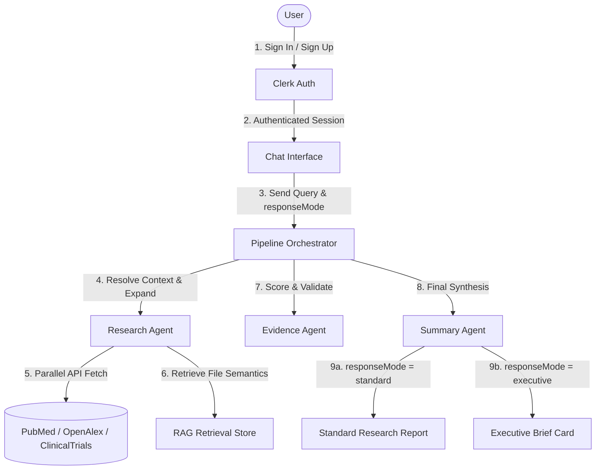
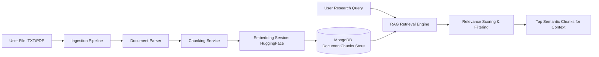
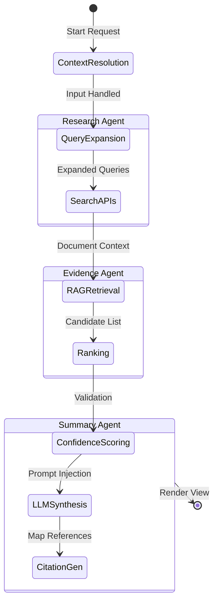

# Curalink AI Research Copilot

> Multi-Agent Research Intelligence for Evidence-Based Decision Making

Curalink is an enterprise-grade AI Research Copilot that performs parallel federated searches across **PubMed**, **OpenAlex**, and **ClinicalTrials.gov**. It scores, ranks, and filters candidate evidence before synthesizing clinical briefs and decision-support summaries.

---

## Key Features

- **Clerk Authentication**: Federated secure login & user-scoped document encryption.
- **Multi-Session Chat**: Dynamic session tracking with historical context persistence.
- **Federated Database Retrieval**: Simulataneous querying of PubMed, OpenAlex, and ClinicalTrials.gov.
- **Vector-Based RAG Ingestion**: Upload and parse `TXT` or `PDF` files to ground queries.
- **Multi-Agent Orchestration**: Collaborative Research, Evidence, and Summary Agent pipeline.
- **Executive Mode**: Dynamic CEO briefings detailing findings, risks, and recommendations.
- **Evidence Analytics**: Visualized dashboard metrics for source distributions and agent performance.

---

## Project Structure

```
AI-Medical-Research-Assistant/
├── server/         # Express + MongoDB backend pipeline
└── client/         # React + Vite + Tailwind CSS v4 + Recharts frontend
```

---

## Core System Architecture

### 1. Request Flow & Clerk Authentication
This diagram illustrates the user authentication flow and request execution pipeline.



### 2. Retrieval-Augmented Generation (RAG) Architecture
Ingested patient files or guidelines are securely vectorized and mapped for localized context grounding.



### 3. Multi-Agent Reasoning State Workflow
Curalink orchestrates three sequential agents to compile, filter, and summarize clinical queries.



---

## Tech Stack

### Frontend (`client/`)
- **Framework**: React 19 + TypeScript
- **Routing**: TanStack Router (file-based)
- **State & Data Fetching**: TanStack Query
- **Charts & Data Viz**: Recharts (Pie, Line, and Bar charts)
- **Styling**: Tailwind CSS v4
- **Icons**: Lucide React

### Backend (`server/`)
- **Runtime**: Node.js + Express
- **Database**: MongoDB (Mongoose Schema mapping)
- **Auth**: Clerk JWT Session verification
- **LLM/Embeddings**: HuggingFace Inference Client / Ollama (local)

---

## Getting Started

### 1. Environment Configurations

Create a `.env` file in the `/server` directory:
```env
PORT=5000
MONGODB_URI=mongodb://localhost:27017/curalink
CLERK_PUBLISHABLE_KEY=pk_test_...
CLERK_SECRET_KEY=sk_test_...
LLM_PROVIDER=huggingface
HF_API_TOKEN=hf_...
HF_MODEL=mistralai/Mistral-7B-Instruct-v0.3
```

Create a `.env` file in the `/client` directory:
```env
VITE_CLERK_PUBLISHABLE_KEY=pk_test_...
VITE_API_URL=http://localhost:5000/api
```

### 2. Installation & Run Instructions

**Start the Backend API:**
```bash
cd server
npm install
npm run dev
```

**Start the Frontend App:**
```bash
cd client
npm install
npm run dev
```

Open your browser to **http://localhost:3000** (or the dev URL printed in terminal).
