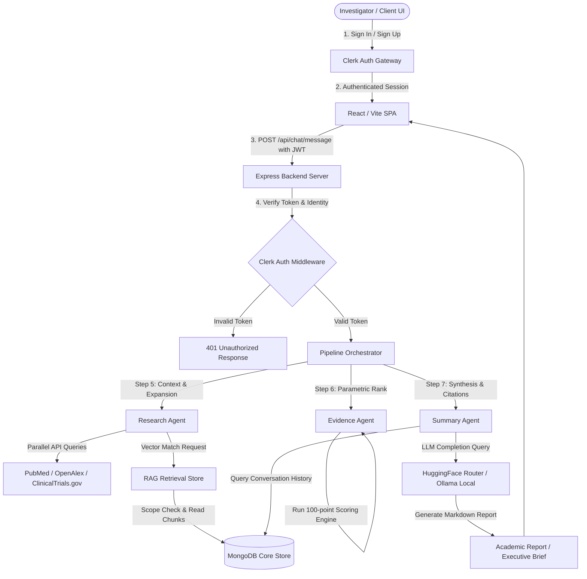
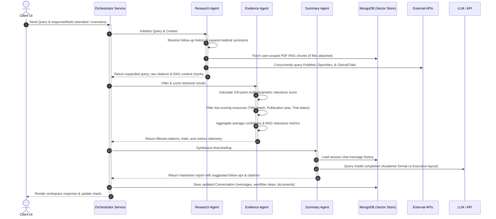

# Curalink AI Research Copilot

> Multi-Agent Research Intelligence for Evidence-Based Clinical Decision Support

Curalink is an enterprise-grade AI Research Copilot designed to accelerate clinical trials evaluation and scientific literature aggregation. Built with a modular multi-agent architecture, Curalink conducts parallel federated queries across **PubMed**, **OpenAlex**, and **ClinicalTrials.gov**, applies a custom multi-parametric scoring algorithm to rank findings, and executes Retrieval-Augmented Generation (RAG) over uploaded patient records to deliver structured academic synthesis or strategic executive briefings.

The application enforces zero-trust multi-tenancy via **Clerk JWT scope verification**, isolating all user conversations, local RAG vector partitions, and diagnostic telemetry.

---

## Problem

Clinical research and medical decision-support workflows face critical speed and execution bottlenecks:

* **Research Overload**: Over 1.5 million peer-reviewed medical papers are published annually. Clinicians and researchers spend over 70% of their workflow hours searching databases, translating query synonyms, and compiling literature reviews.
* **Evidence Discovery Challenges**: Traditional database portals lack cross-index relevance mapping. Finding active clinical trials, analyzing their entry eligibility parameters, and comparing them with publication abstracts requires manual, multi-tab coordination.
* **Decision-Making Delays**: Converting complex scientific abstracts into high-level, actionable risk assessments for executives, pharmaceutical sponsors, or lead investigators creates delays in patient protocol matching and drug pipeline development.

---

## Solution

Curalink solves the clinical discovery bottleneck by orchestrating specialized AI micro-agents, a localized RAG vector indexing pipeline, and customizable synthesis modes:

* **Orchestrated Multi-Agent Workflows**: A three-tier sequential agent sequence (Research → Evidence → Summary) handles query expansion, federated query execution, quality filtration, and final clinical synthesis.
* **Parametric Evidence Ranking**: A custom 100-point scoring algorithm ranks candidates based on study recency, journal authority metrics, and query semantic congruence.
* **Document Intelligence**: RAG context is injected from uploaded PDF/TXT files (e.g., patient genotypic records, hospital protocols), grounding the synthesis with precise, user-supplied medical data.
* **Executive Mode Synthesizer**: Converts verbose academic prose into executive briefings detailing strategic findings, risk matrices, and recommended actions tailored for medical directors and startup managers.

---

## Features

* **Secure Clerk Authentication**: Enterprise-grade registration and login, with all API calls validated via Clerk JWT session tokens.
* **Zero-Leakage Multi-Tenancy**: All conversation memory, uploaded files, and vector embeddings are partitioned by Clerk user scopes.
* **Parallel Federated Retrieval**: Queries are executed concurrently across OpenAlex, PubMed, and ClinicalTrials.gov.
* **Medical Query Expansion**: Normalizes input parameters and injects clinical synonyms to expand retrieval recall.
* **Custom Evidence Scoring (100-Point Engine)**: Computes relevance based on publication timeline decay, title congruence, and journal sources.
* **Local RAG Pipeline**: Secure text extraction (`pdf-parse`) and overlap-safe paragraph chunking for patient dossiers.
* **Multi-Provider Embedding Options**: Support for OpenAI (`text-embedding-3-small`), HuggingFace inference, or a local deterministic fallback.
* **Executive Mode**: A stateful UI/LLM toggle to compile academic reports or executive action briefings.
* **Visual Agent Telemetry**: Step-by-step diagnostic logging charting processing latencies, citation densities, and agent statuses.
* **Interactive Research Analytics**: Charts database footprint, decade publication trends, and system latency.

---

## System Architecture

The diagram below maps the client-to-agent request lifecycle, illustrating how the Express backend utilizes Clerk JWT authorization and orchestrates federated APIs alongside the local database.



---

## Agent Workflow

The `Orchestrator` coordinates three distinct agents sequentially to build, score, and compile research reports.



### Agent Responsibilities

1. **Research Agent**: Resolves conversational history to support follow-up prompts, matches active patient profiles, translates input criteria into expanded medical terms, and queries external APIs and local RAG indexes.
2. **Evidence Agent**: Evaluates citations, computes confidence metrics, applies relevance filters (such as year thresholds or status checks), and returns telemetry data.
3. **Summary Agent**: Reviews chat history, feeds research context into the LLM, extracts suggestions, maps source citations, and structures the final output.

---

## RAG Pipeline

Curalink's Retrieval-Augmented Generation pipeline indexes TXT and PDF documents, creating secure vector partitions that are searchable by cosine similarity matching.

```mermaid
flowchart TD
    subgraph Ingestion
        A[Upload PDF/TXT Document] --> B[Validation Check: Size & Mime]
        B --> C[Parse Text: pdf-parse]
        C --> D[Chunking Service: 2500 chars, 250 overlap]
        D --> E[Embed Chunks: OpenAI/HF/Local Hash]
        E --> F[(Store: MongoDB DocumentChunks)]
    end
    
    subgraph Retrieval
        G[User Query Input] --> H[Generate Query Embedding]
        H --> I[Fetch Chunks: Scoped to User & Document IDs]
        I --> J[Compute Cosine Similarity Metrics]
        J --> K[Filter: similarity >= 0.15]
        K --> L[Slice: Top-K Chunks]
        L --> M[Inject Context to LLM Prompt]
    end
```



### Ingestion & Vector Metrics
* **Chunking Strategy**: Content is segmented using paragraph breaks, falling back to sentence boundaries. The target size is **2,500 characters** with a **250-character overlap** to maintain semantic continuity.
* **Vector Embeddings**: Vectors are configured using OpenAI `text-embedding-3-small` (1536-d) or HuggingFace `sentence-transformers/all-MiniLM-L6-v2` (384-d).
* **Search Execution**: Queries generate a vector representation, which is compared using cosine similarity against the database chunks. Chunks scoring below `0.15` are discarded.

---

## Tech Stack

### Frontend (`client/`)
* **Framework**: React 19 (TypeScript)
* **Routing**: TanStack Router (File-based code splitting)
* **State Management**: TanStack Query (React Query)
* **Visual Charts**: Recharts (Pie, Line, and Bar widgets)
* **Styling**: Tailwind CSS v4
* **Icons**: Lucide React

### Backend (`server/`)
* **Runtime**: Node.js + Express
* **Database**: MongoDB (Mongoose schemas)
* **Authentication**: Clerk JWT Session verification
* **AI Providers**: HuggingFace Router API / Local Ollama (fallback)

---

## Database Models

All models are defined inside `server/models/` and map to MongoDB collections via Mongoose.

### 1. Conversation (`models/Conversation.js`)
Stores chat sessions, query parameters, returned citations, and agent execution times.
* `conversationId` (String, unique): Session UUID.
* `userId` (String, indexed): Clerk identity token.
* `diseaseContext`, `patientName`, `locationContext` (Strings): Context filters.
* `messages` (Array): Chronological log of messages containing role, content, mode, publications, clinical trials, RAG chunks, and workflow metrics.

### 2. Document (`models/Document.js`)
Tracks metadata for files uploaded by the user.
* `documentId` (String, unique): File UUID.
* `userId` (String, indexed): Owner's identity scope.
* `filename`, `mimeType`, `fileSize`: Standard file details.
* `status` (String): `processing` | `ready` | `failed`.
* `chunkCount`, `charCount`, `embeddingModel`, `embeddingDimensions`.

### 3. DocumentChunk (`models/DocumentChunk.js`)
Contains the text chunks and vector embeddings used for retrieval.
* `chunkId` (String, unique): Chunk UUID.
* `documentId` (String, indexed): Mapped file ID.
* `userId` (String, indexed): Scope validation.
* `index` (Number): Sentence sequencing number.
* `text` (String): Segmented content string.
* `tokenEstimate` (Number): Approximate token count.
* `embedding` (Array of Numbers): Dense numerical feature vector.

### 4. UserProfile (`models/UserProfile.js`)
Stores history and query preferences for clinical users.
* `userId` (String, unique): Clerk identity token.
* `name`, `conditions` (Array of Strings).
* `preferences`: Preferred database indexes and location settings.
* `queryHistory` (Array): Log of user queries.

---

## API Overview

All routes require a valid Clerk Session JWT passed in the HTTP Authorization header.

### Chat Endpoints (`/api/chat`)
* `POST /message`: Triggers the orchestrator pipeline for structured queries.
* `GET /conversation/:conversationId`: Retrieves a session's chat log.
* `GET /conversations`: Returns a list of the user's active chat sessions.
* `POST /conversation/new`: Creates a new chat session.
* `DELETE /conversation/:conversationId`: Deletes a chat session.
* `GET /analytics`: Gathers statistics on system latency, source distribution, and research growth.

### Document Endpoints (`/api/documents`)
* `POST /upload`: Ingests and chunk-embeds a PDF/TXT file.
* `GET /`: Lists all documents uploaded by the authenticated user.
* `GET/:documentId`: Inspects specific document status.
* `DELETE/:documentId`: Removes document records and corresponding text chunks.

---

## Installation

### Prerequisites
* Node.js (v18+)
* MongoDB instance (local or Atlas)
* Clerk Developer Account
* HuggingFace Hub Token or local Ollama running.

### 1. Repository Setup
```bash
git clone https://github.com/aggisanjay/AI-Medical-Research-Assistant.git
cd AI-Medical-Research-Assistant
```

### 2. Backend Installation
```bash
cd server
npm install
# Create .env and configure variables
npm run dev
```

### 3. Frontend Installation
```bash
cd ../client
npm install
# Create .env and configure VITE_CLERK_PUBLISHABLE_KEY
npm run dev
```

---

## Environment Variables

### Backend Configuration (`server/.env`)
```env
PORT=5000
MONGODB_URI=mongodb://localhost:27017/curalink
CLERK_SECRET_KEY=sk_test_...

# LLM provider: ollama or huggingface
LLM_PROVIDER=huggingface
HF_API_TOKEN=hf_...
HF_MODEL=Qwen/Qwen2.5-7B-Instruct

# Embeddings: local | huggingface | openai
EMBEDDING_PROVIDER=local
# OPENAI_API_KEY=sk-...  # Required only if provider is openai
```

### Frontend Configuration (`client/.env`)
```env
VITE_CLERK_PUBLISHABLE_KEY=pk_test_...
VITE_API_URL=/api
```

---

## Deployment

### Frontend (Static SPA hosting)
Deploy the built client output (`dist/`) using hosting providers like Vercel, Netlify, or AWS Amplify:
```bash
cd client
npm run build
```
Ensure client env variable `VITE_CLERK_PUBLISHABLE_KEY` is set in your hosting provider configuration, and adjust API routing variables if the backend uses a separate URL.

### Backend Application
Deploy the Node/Express backend to containers (such as Render, Railway, fly.io, or Heroku):
- Set all backend variables (`CLERK_SECRET_KEY`, `MONGODB_URI`, `HF_API_TOKEN`) in the provider dashboard.
- Connect your database cluster.

### MongoDB Atlas Setup
1. Create a MongoDB Atlas cluster and whitelist the deployment IP.
2. Retrieve the connection string: `mongodb+srv://<user>:<password>@cluster.mongodb.net/curalink`.
3. Set the connection string in the backend's environment variables as `MONGODB_URI`.

---

## Future Improvements

* **Deep-Search Genomic Tooling**: Integrate Ensembl and NCBI dbSNP APIs to map mutation markers directly inside literature queries.
* **Advanced Vector Graph Integration**: Deploy hybrid Neo4j graph stores alongside MongoDB vector chunks to trace direct scientific relationships.
* **Hypothetical Protocol Sandbox**: Allow researchers to draft clinical trial plans and use agent workflows to identify potential recruitment conflicts.

---

## Screenshots

Below are placeholder layouts demonstrating Curalink's user experience.

### Landing Page
```
+------------------------------------------------------------+
| Curalink [Enterprise AI]                      Workspace    |
|                                                            |
|        AI Research Copilot for Evidence-Based              |
|                   Decision Making                          |
|                                                            |
|   [ Get Started Now ]           [ View Interactive Demo ]  |
+------------------------------------------------------------+
```

### Research Workspace
```
+-----------------------+------------------------------------+
|  Navigation           | [User Query]                       |
|  * Workspace [Active] | Immunotherapy for melanoma...     |
|  * Documents Store    |                                    |
|                       | [Pipeline Execution Log]           |
|  Recent Research      | - Research Agent (completed)       |
|  * melanoma study     | - Evidence Agent (completed)       |
|  * AD biomarkers      | - Summary Agent  (generating...)   |
+-----------------------+------------------------------------+
```

### Agent Workflow
```
+------------------------------------------------------------+
|                  Agent Pipeline Telemetry                  |
|                                                            |
|  [ Research Agent ] -----> [ Evidence Agent ] -----> [ SA ]|
|  * Synonym expansion       * Relevance scoring       * Gen |
|  * 320ms latency           * 110ms latency           * Lat |
+------------------------------------------------------------+
```

### Executive Mode
```
+------------------------------------------------------------+
|  Brief Synthesis Preview            [Toggle Output: Executive]
|                                                            |
|  ## Executive Brief                                        |
|  * Key Findings: Combinations show 52% survival enhancement|
|  * Risks: Adverse events require patient genotyping        |
|  * Recommended Actions: Initiate pilot validation cohort   |
+------------------------------------------------------------+
```

### Analytics Dashboard
```
+------------------------------------------------------------+
|                      System Telemetry                      |
|                                                            |
|  [ Latency Trends ]      [ Database Index ] [ Pub Growth ] |
|  |||..|||..||..|||       - PubMed: 36M      ..|..|..||.||  |
|  Average: 1.88s          - OpenAlex: 250M   oncology index |
+------------------------------------------------------------+
```
